# Report answers and evidence checklist

> **Screenshot filing made simple:** screenshots are grouped under `evidence/` by topic. The checklist is in [EVIDENCE_GUIDE.md](EVIDENCE_GUIDE.md). The same images are included in this report's appendix.

**Course:** Data Engineering  
**Assignment:** From Git to Gold  
**Student:** Mahima Pandey  
**Roll number:** 23BCS155  
**Repository:** https://github.com/mahip004/freshcart-pipelines

This report uses the assignment brief, instructor-supplied FreshCart materials, and the student's screenshots. The submitted FreshCart notebook is sanitized: instructor credentials and outputs were removed, and the currency rule and sixth quality check were added. Snowflake and RabbitMQ were run in the student's own environments. The report includes the available GitHub, Snowflake, RabbitMQ, and Mage run evidence and explains the assignment scenarios.

## A. Git and CI/CD

### A1. Repository

The public repository is live at `https://github.com/mahip004/freshcart-pipelines`. It has separate commits for the project overview, CI, Mage blocks, FreshCart notebook, stream scripts, and report. `git log --oneline` output at report preparation time:

```text
ceab90e Mark identity and repository checklist complete
1ef4134 Update submission status with verified CI runs
053933e Personalize report and record CI run evidence
93ed60e Restore the 80/20 split after the failing CI demonstration
adbcea7 Demonstrate failing CI with a 30 percent test split
a5658bd Fix pytest module import path in CI
113419e Document remaining account-run evidence
dd3952f Add numbered assignment answers and evidence checklist
a0c4256 Add Mage pipeline metadata at the CLI pipeline path
6f87031 Place the exporter in Mage's data_exporters directory
dfdfc4a Place the loader in Mage's data_loaders directory
1c6319e Add topic-matched drivers with ACK and NACK handling
037fb86 Add the topic exchange order dispatcher
b862ff4 Document the RabbitMQ run procedure and ACK behavior
1daf67a Add the sanitized FreshCart notebook with validation checks
00a605e Add FreshCart SQL validation and idempotency patterns
5fdd327 Add the Iris pipeline inspection notebook
f3be08c Wire the Mage pipeline and evaluation branch
9c279cd Add the predictions exporter block
4edec14 Add the evaluation branch with metrics
1a25367 Add the tested decision tree block
abc6c5a Add the reproducible train-test split block
b23b6cc Add the dataset validation block
fc0e2f3 Add the Iris data loader block
55a46ae Initialize Mage exporter package
da5c5bf Initialize Mage transformer package
c2e6e72 Initialize Mage loader package
8a774cf Initialize the Iris project package
518e96d Run pytest on pushes and pull requests
b1a949a Add the Iris split regression test
dd495df Declare Python project dependencies
e7fa66d Ignore secrets and generated artifacts
c230113 Add project overview and setup instructions
```

### A2. Git command table

| Command | Where the change happens | What exactly happens |
|---|---|---|
| `git init` | Working folder and local Git metadata | Creates a `.git` repository so Git can track this folder. |
| `git add train.py` | Staging area | Stages the current file contents for the next commit. |
| `git commit -m "msg"` | Local repository | Saves a snapshot of staged changes as a local commit. |
| `git remote add origin URL` | Local Git configuration | Records the remote URL under the name `origin`. |
| `git push -u origin main` | Remote Git | Uploads local `main` commits and sets upstream tracking. |
| `git pull origin main` | Local working folder and local Git | Fetches remote commits and integrates them into the current branch. |

After `git commit`, a teammate cannot see the code on GitHub yet: the commit exists only in the local repository until pushed to a remote.

### A3. CI

`tests/test_prepare_data.py` checks the required 120/30 split and the workflow runs pytest on pushes and pull requests using Python 3.12. The green run passed after the import-path fix: [Actions run](https://github.com/mahip004/freshcart-pipelines/actions/runs/42240057166). The temporary `test_size=0.3` commit failed as expected with 105 training rows instead of 120: [intentional failing run](https://github.com/mahip004/freshcart-pipelines/actions/runs/42240222845). Restoring `0.2` passed: [fix run](https://github.com/mahip004/freshcart-pipelines/actions/runs/42240377107). The appendix includes the commit/check summary screenshot.

## B. FreshCart ELT on Snowflake

The instructor notebook supplies the DDL, mock API fixtures and transformations. The target values from the assignment are compared with the captured baseline outputs below.

### B1. Baseline

| Check | Expected result from brief | Actual run |
|---|---:|---|
| Bronze raw orders | 8 per extraction | 16 in the final table after two append-only extractions |
| Silver clean | 6 | 6 |
| Quarantine | 2: ORD-1004, ORD-1006 | 2 |
| Deduplicated orders | 4 | 4 |
| Gold aggregate | 4 orders; ₹7,785.00; 126 points | 4 orders; ₹7,785.00; 126 points |
| Rejected share | 25% | 25% |

**Captured result:** one extraction contained 8 input records (6 web and 2 mobile). The final bronze-table screenshot shows 16 rows, consistent with two append-only extracts. Silver clean contains 6 rows, quarantine 2, deduplicated orders 4, and Gold 4 orders, ₹7,785.00 revenue, and 126 points. The run reports 25% rejected and zero for each displayed quality check.

**Evidence:** baseline summary, bronze source rows, silver rows, and quarantine/dedup results are in the Snowflake appendix. The separate connection screenshot is excluded because it displays account/user details.

### B2. Record trace

ORD-1003's website bronze JSON uses flat keys such as `order_id`, `cust_email`, `cust_name`, `order_date`, `amount`, and `updated_at`; the mobile bronze JSON uses `orderId`, nested `customer.email` and `customer.name`, `orderDate`, nested `total.value` and `total.currency`, `deliveryPin`, and `updatedAt`. `SQL_10_ORDERS_CLEAN` maps these with `raw:order_id::STRING` etc. for web and `raw:orderId::STRING`, `raw:customer.email::STRING`, `raw:total.value::STRING` etc. for mobile. Both become normalized `order_id`, `email`, `name`, `order_date`, `amount`, `currency`, `pincode`, and `updated_at`; `LOWER(TRIM(...))`, `INITCAP`, `COALESCE(TRY_TO_DATE(...))`, and `TRY_TO_DECIMAL(REGEXP_REPLACE(...))` standardize them. `SQL_20_ORDERS_DEDUP` keeps the later mobile row using `QUALIFY ROW_NUMBER() OVER (PARTITION BY order_id ORDER BY updated_at DESC, ingest_seq DESC) = 1`. Meera's order is INR 2,100, so the FX rate is 1; Platinum's multiplier is 3, giving `FLOOR(2100 / 100) × 3 = 21 × 3 = 63` points.

ORD-1005's date is 2026-09-03, when Priya's SCD2 tier becomes Gold. The order-date range join to `dim.customers_scd2` selects Gold, then `ref.tier_multiplier` joins on `m.tier = c.tier`; points are `FLOOR(899 / 100) × 2 = 8 × 2 = 16`. ORD-1001 is dated 2026-09-01, so the same point-in-time SCD2 join selects Silver, yielding `FLOOR(1250 / 100) × 1 = 12` points.

### B3. Currency validation

The submitted notebook adds `IFF(currency NOT IN ('INR', 'USD'), 'unsupported_currency', NULL)` to `ARRAY_CONSTRUCT_COMPACT(...)` in `SQL_10_ORDERS_CLEAN`. In the supplied mock data, ORD-1006 already has `bad_email` and `bad_pincode`; with the rule it also has `unsupported_currency` because its normalized currency is EUR. Its gold contribution remains zero because it was already excluded from `silver.orders_clean` and quarantined. The quarantine `INSERT` prevents another copy with the same source, null-safe order ID, and `updated_at` through its `NOT EXISTS` clause; a `QUALIFY ROW_NUMBER()` also retains one latest copy per source/order/version.

The added rule flags EUR as `unsupported_currency` while retaining the existing `bad_email` and `bad_pincode` reasons for ORD-1006. The quarantine table prevents duplicate source/order/version records, and the latest row per source/order/version is retained.

### B4. SCD2 and idempotency

**SCD2 outcome:** CUST-02 has a Silver version from 2024-01-15. Adding Gold effective 2026-08-15 creates two versions and closes Silver on 2026-08-14. ORD-1002 is dated 2026-09-01, so the range join assigns Gold. Its INR value is `42.50 × 83.20 = ₹3,536`; loyalty points are `FLOOR(3536/100) × 2 = 70`. Gold points increase from 126 to 161. The changed order row has a new `row_hash`, so the `MERGE` updates `published_at` for ORD-1002.

| Quantity | SCD2 scenario result |
|---|---|---|
| CUST-02 rows in `dim.customers_scd2` | 2; Silver version closes 2026-08-14 |
| Tier used for ORD-1002 | Gold |
| ORD-1002 points | 70 (₹3,536 / 100 rounded down × Gold multiplier 2) |
| Total gold points | 161 (126 + 35) |
| Gold rows with changed `published_at` | 1: ORD-1002 |

`row_hash` gives each output row a fingerprint of relevant business values. The `MERGE` matches on a stable business key and updates a target only when the source hash differs, while inserting previously unseen keys. This prevents a rerun from duplicating unchanged gold facts and lets `published_at` remain stable when content is unchanged. Bronze still grows by eight rows per run because extraction appends a fresh copy of the raw API sample unless the landing/load step itself deduplicates it.

### B5. Quality check and ELT

The notebook adds a sixth check for future orders: `SELECT COUNT_IF(order_date > CURRENT_DATE()) FROM silver.orders_dedup`. The baseline has zero future-dated orders. A valid order dated 2099-01-01 is identified as a problem; after its removal the check returns zero. ELT fits FreshCart because raw data can be loaded quickly into Snowflake and transformed there with SQL, keeping the original landing data available for reprocessing. Snowflake's warehouse can scale the transformations where the data already sits. ETL would win when transformations must happen before loading, such as when policy forbids transferring raw sensitive fields into the destination.

## C. Mage Iris pipeline

### C1. Graph and run

The supplied Mage evidence records `mage run iris_project iris_classifier --test` completing successfully. The terminal output includes passing block tests, evaluation output, and `Pipeline run completed`. The DBT library notice did not stop the run. The evidence appendix includes the terminal run capture and the Mage UI graph.

### C2. Test gate

The supplied run evidence shows `train_model` tested at `max_depth` 1 through 5. Its acceptance threshold is 0.9: depth 1 scores 0.6667 and fails, so the downstream `save_results` exporter does not create `iris_predictions.csv`. Depths 2–5 pass and create the CSV.

| max_depth | Test accuracy | Test passed? | CSV created? |
|---:|---:|---|---|
| 1 | 0.6667 | No | No |
| 2 | 0.9333 | Yes | Yes |
| 3 | 0.9667 | Yes | Yes |
| 4 | 0.9333 | Yes | Yes |
| 5 | 0.9333 | Yes | Yes |

The evidence appendix includes the captured result table. The source PDF has one conflicting figure: its terminal summary displays 0.9567 for depth 3, while the detailed results table and evaluation output show 0.9667. The report uses 0.9667 from the detailed table and evaluation output. The repository source now uses the demonstrated 0.9 gate. Its pipeline also retains the separately prepared `validate_iris` block before `prepare_data`, which is not visible in the supplied Mage graph screenshot.

### C3. Evaluation branch

The supplied Mage run shows `train_model` branching to `save_results` and `evaluate_model`. At depth 3, the confusion matrix is `[[10, 0, 0], [0, 9, 1], [0, 0, 10]]`. Overall accuracy is 0.9667 across 30 test rows. The class 1 recall is 0.9000 and class 2 precision is 0.9091; the macro and weighted F1 scores are both 0.9666. The appendix includes the evaluation metrics table and the terminal run output containing the confusion matrix.

### C4. Own block

The supplied Mage evidence describes a `save_metrics` exporter after `evaluate_model`. It writes the metrics table to `iris_metrics.csv` and includes a test that checks the file exists and is not empty. The appendix includes the Mage graph showing that branch and exporter. The repository includes the `save_metrics` exporter, its non-empty-file test, and the metadata dependency from `evaluate_model`. It also retains the separately prepared `validate_iris` block before `prepare_data`; that block is not visible in the supplied graph screenshot.

## D. Food-order stream

### D1. Topic routing

| # | Routing key | Matching queues |
|---:|---|---|
| 1 | `bangalore.koramangala.food` | Ravi, Meena, Control |
| 2 | `bangalore.indiranagar.ride` | Priya, Arjun, Control |
| 3 | `bangalore.whitefield.ride` | Arjun, Control |
| 4 | `chennai.tnagar.food` | Karthik |
| 5 | `chennai.whitefield.ride` | dropped |
| 6 | `bangalore.koramangala` | Control only |

These queue matches follow RabbitMQ topic-pattern rules. For key 6, `#` in `bangalore.#` matches zero or more words, so Control matches it. The driver patterns containing `*` require exactly one word after the zone or city and all city.zone.type patterns have three words; none match the two-word key.

### D2. Build and run

`stream/dispatcher.py` publishes JSON every two seconds to the durable `rapido-dispatch` topic exchange. `stream/driver.py NAME PATTERN` creates a private exclusive queue, binds the topic, prints deliveries and ACKs valid messages. The screenshots show published routing keys and RabbitMQ UI activity with three temporary queues/consumers.

### D3. ACK/NACK

A message without `zone` is rejected with `basic_nack(requeue=False)`; valid messages are ACKed. The dispatcher emits one malformed message every ten. If a driver crashes before ACK, the broker can redeliver the unacknowledged message after the connection closes. With `requeue=True`, a permanently malformed message may circulate continuously; rejecting without requeue or routing it to a dead-letter queue prevents a poison-message loop.

## E. Integration and reflection

```text
Git working tree → commits → GitHub remote → Actions CI
                                  │
                                  ├── tests Mage blocks before saving model output
                                  ├── FreshCart raw API → bronze → silver/quarantine → gold in Snowflake
                                  └── RabbitMQ topic stream → driver queues
```

The project combines version control, automated checks, a Snowflake batch pipeline, an Iris Mage pipeline, and RabbitMQ topic routing.

**Reflection:** The intentional CI failure was caused by temporarily changing the test split to 30%, which produced 105 training rows instead of the required 120. The failed GitHub check exposed the mismatch. Restoring the 80/20 split returned the expected 120 training rows and 30 test rows, and the follow-up Actions run passed.

## Final evidence checklist

- [x] Add Mahima Pandey, roll number 23BCS155, and the GitHub repository URL to the cover.
- [x] Publish the repo with separate meaningful commits and include `git log --oneline`.
The report includes the supplied GitHub, Snowflake, RabbitMQ, and Mage evidence. The intentional CI failure and passing fix provide the reflection example. The Mage appendix uses the run output, depth results, evaluation metrics, and graph from the supplied Part C PDF.

## Evidence appendix - captured screenshots

### GitHub

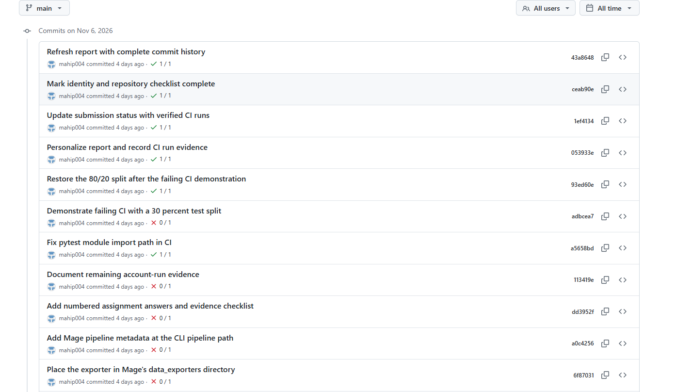

### Snowflake

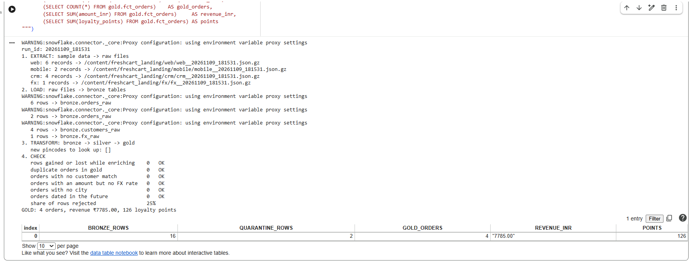

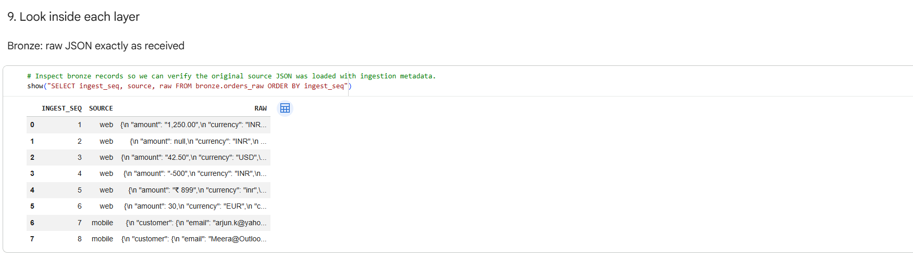

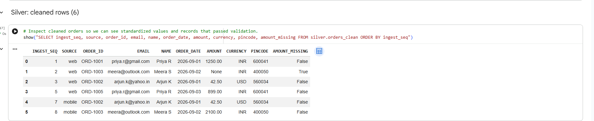

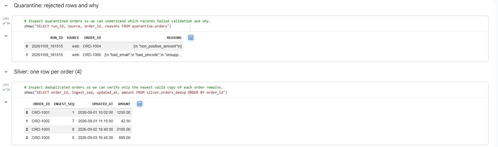

### RabbitMQ

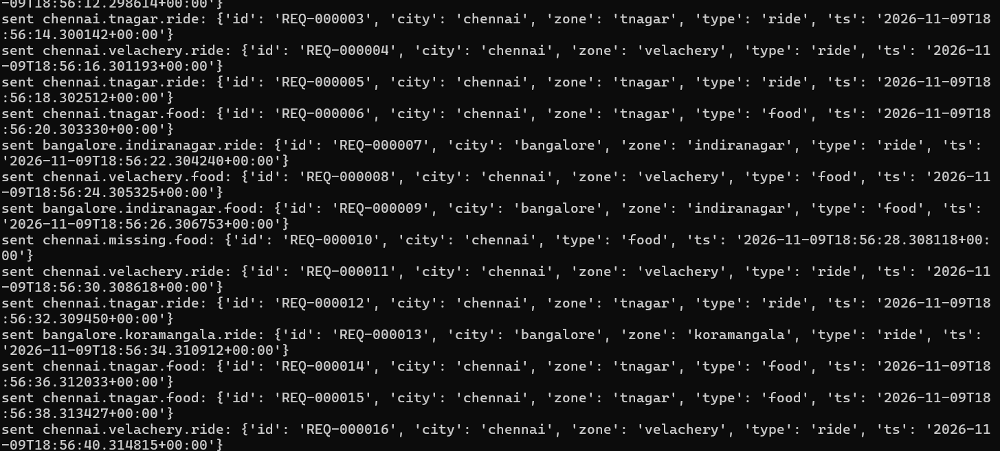

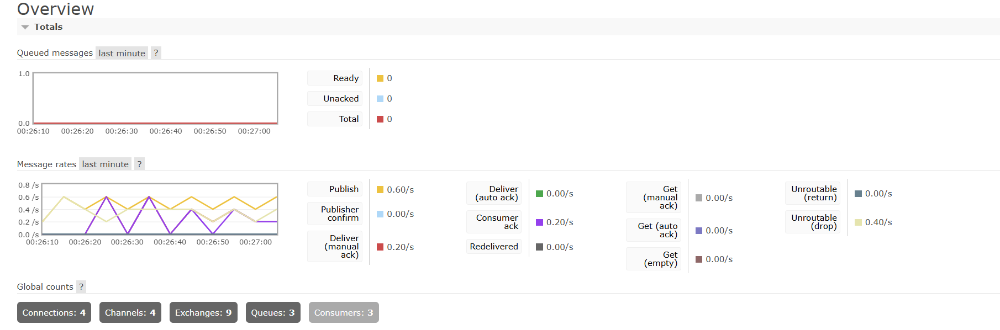

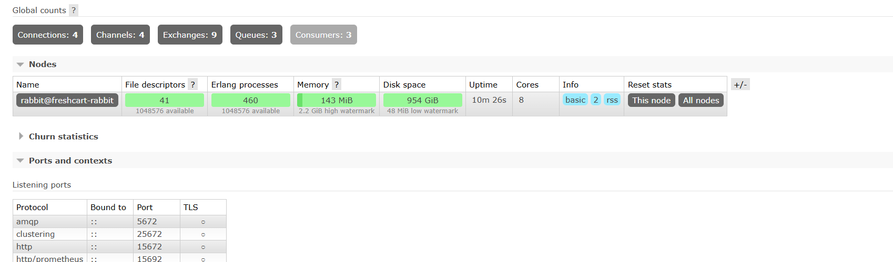

### Mage

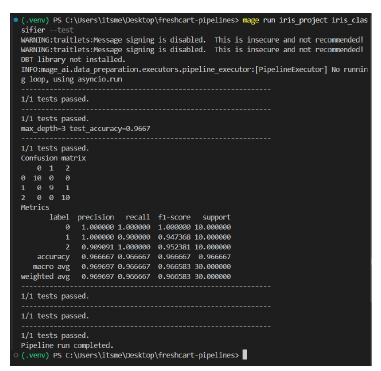

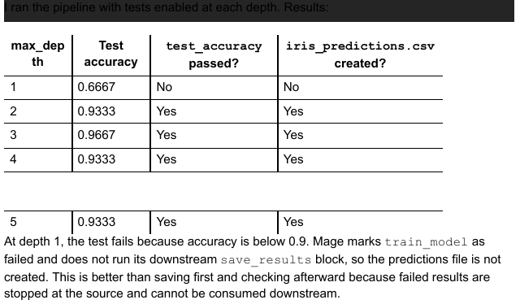

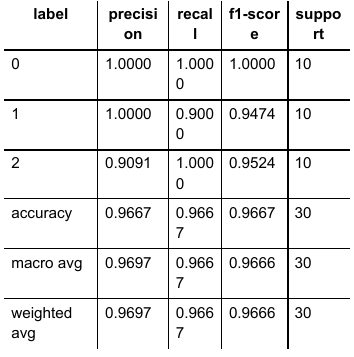

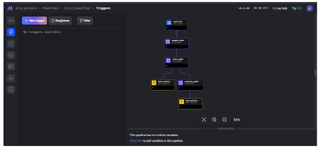
